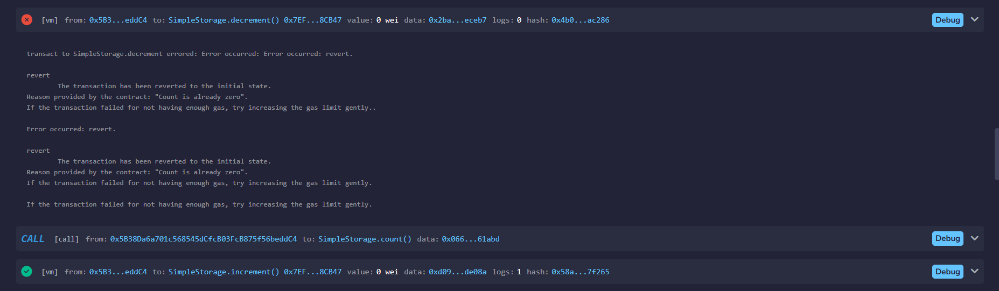
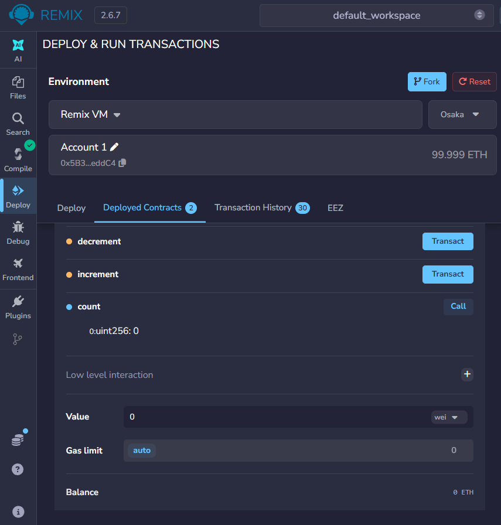

# CodeAlpha_SimpleStorage

Task 1 of the CodeAlpha Blockchain Development Internship.

## What it does
A Solidity smart contract that stores one integer on the blockchain.
- `count`: public variable, readable by anyone
- `increment()`: increases the value by 1
- `decrement()`: decreases the value by 1 (reverts if already 0)
- `CountChanged` event is emitted on every change

## How to run (Remix IDE)
1. Open https://remix.ethereum.org
2. Create `SimpleStorage.sol` and paste the code from `/contracts`
3. Compile with Solidity 0.8.20 or newer
4. Deploy using the Remix VM environment
5. Test the functions below

## Test results
| Action | Expected | Result |
|---|---|---|
| Read `count` after deploy | 0 | Pass |
| `increment` x3 | 3 | Pass |
| `decrement` x1 | 2 | Pass |
| `decrement` below 0 | Revert: "Count is already zero" | Pass |

## Screenshots

## Concepts demonstrated
State variables, public getters, functions, require() validation, events.
